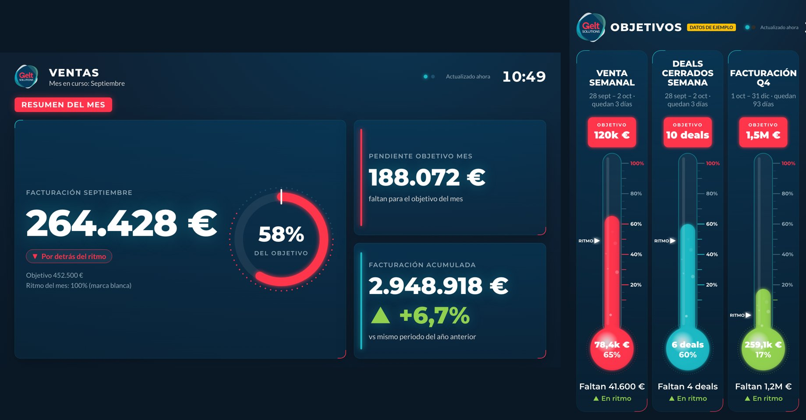

# Dashboards TVs · Gelt Solutions

Sistema de pantallas de oficina: dos teles (horizontal y vertical) movidas por una Raspberry Pi 5,
un reloj LED Ulanzi TC001 en la mesa de dirección y un gestor web de contenidos.
Nació como prueba (sept–oct 2026) y funciona en producción en la oficina.



## Qué hace

| Pantalla | Contenido |
|---|---|
| TV horizontal (HDMI0) | Resumen del mes B2B · Venta por KAM · Histórico de facturación total compañía (desglose Promo/data, Users, GiftCards) · pantallas de contenido |
| TV vertical (HDMI1, girada 270°) | Termómetros de objetivos · pantallas de contenido |
| Reloj TC001 | 4 KPIs B2B; avisa de facturas nuevas, objetivo cumplido y ventas |
| Gestor web | Pantallas (7 plantillas), Termómetros, Integraciones (Pipedrive), Celebración de ventas, botón "Anunciar venta" |

Celebración de ventas: al pulsar "Anunciar venta" en el gestor, o al marcarse un deal como **Ganado** en Pipedrive,
las dos teles muestran una animación a pantalla completa con ráfaga de sonido (por la horizontal) y el reloj avisa.

## Arquitectura

```
Google Sheet (pestaña Display, CSV publicado) ──► dashboard.html / termometros.html (Chromium kiosko)
                                              └─► reloj TC001 (script Berry, lee el CSV cada 15 min)
Raspberry Pi 5 ─ server.py :8080 ─┬─ sirve web/ y content/media
                                  ├─ API del gestor (pantallas, termómetros, medios, sesión)
                                  ├─ /api/events  ◄── teles preguntan cada 3 s (ventas)
                                  └─ poller Pipedrive (45 s) ──► deals ganados ──► /api/events + aviso al reloj
```

- Sin backend en la nube: todo vive en la Raspberry y lee el Sheet público por CSV.
- El gestor solo es accesible desde la red de la oficina (decisión de negocio); contraseña única con hash PBKDF2.
- Plantillas y estilo: identidad Gelt (azul `#063B5D`, cian `#1AB8C4`, rojo `#FF344C`, Montserrat + Lato), look "HUD/neón".

## Estructura

```
web/                 Lo que sirve la Raspberry (se copia a ~/dashboard/www)
  dashboard.html     TV horizontal (datos del Sheet + pantallas del gestor + celebración)
  termometros.html   TV vertical (termómetros del Sheet y del gestor + pantallas)
  admin.html         Gestor de contenidos
  cms.js             Plantillas, utilidades del Sheet, sonido y celebración de ventas (compartido)
  dashboard-prueba.html  Modo prueba con un solo monitor (alterna horizontal y vertical girada)
  FORMATO-SHEET.md   Formato de la pestaña Display (KPIs, KAM, histórico, desglose, bloques)
  assets/            Logo y favicon Gelt
raspberry/
  server.py          Servidor + API + Pipedrive (Python 3, sin dependencias)
  kiosk.sh           Lanza un Chromium a pantalla completa por tele
  watchdog.sh        Recoloca todo si una tele se apaga/enciende
  tv.sh              Encender/apagar teles (HDMI-CEC + corte de señal)
  setup.sh           Instalación en una Raspberry nueva (ver abajo)
  config/            kanshi (pantallas), crontab, autostart y reglas de ventana de labwc
reloj-tc001/
  ventas.be          Script Berry para AWTRIX NG
contenido/           Copia del contenido del gestor (sin contraseña ni token)
docs/                Capturas y notas
```

## Configuración fija en el código (revisar al migrar)

| Valor | Dónde |
|---|---|
| URL CSV publicada del Sheet | `web/cms.js` (CSV_URL), `web/dashboard.html` y `web/termometros.html` (CONFIG.csvUrl), `reloj-tc001/ventas.be` (@config url) |
| IP del reloj TC001 (192.168.1.85) | `raspberry/server.py` (variable de entorno `DASH_AWTRIX`) |
| Horario de oficina para sonido (L-V 9–19) | `CONFIG.officeDays/From/To` en dashboard.html y termometros.html |
| Horario teles (L-V 9:00 on / 19:00 off) y reinicio 3:30 | `raspberry/config/crontab` |
| Giro de la tele vertical (270°) | `raspberry/config/kanshi.config` |

## Instalación en una Raspberry nueva

Raspberry Pi 5 (4 GB), Raspberry Pi OS 64-bit con escritorio (Debian 13 / labwc), usuario `gelt`, hostname `dashboard`, SSH con clave.

```bash
scp -r web raspberry contenido gelt@dashboard.local:/tmp/dashboards-tvs/
ssh -t gelt@dashboard.local "bash /tmp/dashboards-tvs/raspberry/setup.sh"
```

`setup.sh` copia los archivos, configura pantallas, arranque automático, cron, WiFi sin ahorro de energía y el permiso
de reinicio. Pide la contraseña de sudo una vez. **No se ha probado en limpio**: se escribió a partir de la instalación
que funciona en la oficina. Tras instalar: abrir `http://dashboard.local:8080/admin.html`, crear la contraseña del gestor
y, en Integraciones, pegar un token de Pipedrive.

## Operación

- Desplegar cambios de `web/`: `rsync -a --delete web/ gelt@dashboard.local:dashboard/www/` y recargar teles
  (`pkill -x chromium` + `~/dashboard/kiosk.sh` con `XDG_RUNTIME_DIR=/run/user/$(id -u) WAYLAND_DISPLAY=wayland-0`).
- Cambios de `server.py`: copiar y reiniciar el proceso (ver CLAUDE.md, ojo con `pkill -f`).
- Datos persistentes en la Raspberry: `~/dashboard/content/` (slides.json, thermos.json, celebration.json, media/,
  events.json, auth.json = hash contraseña, pipedrive.json = token, permisos 600).

## Reloj TC001

- Firmware AWTRIX NG 1.1.2 ([releases](https://github.com/Blueforcer/awtrix-ng/releases)), imagen `usb-awtrix-ng-4mb.bin`.
- Flasheo con esptool a **115200 baud** y sin hub (el chip CH340 da errores a más velocidad).
- Subir script: `curl -X PUT http://<ip>/api/v1/apps/script/ventas -H "Content-Type: text/plain" --data-binary @reloj-tc001/ventas.be`
- Existe una copia del firmware anterior (AWTRIX 3) en el Mac de Carlos; no se incluye porque contiene la clave de la WiFi.

## Pendiente

1. Apagado/encendido automático de las LG: activar en cada tele SIMPLINK, "Sincronización automática de encendido",
   apagado automático sin señal y desactivar "Siempre listo"; luego probar `tv.sh off/on`.
2. Crear termómetros en el gestor (la vertical está vacía).
3. Sustituir el sonido de celebración por uno definitivo (actual: "Rapid Machine Gun Burst" de BudgetPixel AI, CC BY 4.0, ver contenido/CREDITOS.txt).
4. Si el Google Sheet se alimenta desde un portátil, mover esa alimentación a un servicio siempre encendido (o leer Pipedrive directamente desde la Raspberry).
5. Ideas: venta por KAM y pipeline por fase leídos de Pipedrive; reloj silencioso fuera de 9–19; cable Ethernet para la Raspberry.
